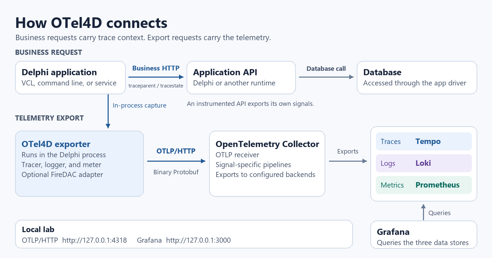

# OTel4D

OTel4D is an independent Delphi library that sends traces, logs, and metrics from a Windows application to an OpenTelemetry Collector or compatible receiver. It uses binary Protobuf over OTLP/HTTP and interoperates with applications in other languages through W3C Trace Context. Optional FireDAC components capture blocking database operations. The verified target is Delphi 10.2 Tokyo Win32.



## Get started

1. [Build the runtime package or link the sources](docs/integration.md#link-an-existing-application) and add `OTel.Api` to your Delphi application.
2. [Start a local Collector](docs/integration.md#run-the-local-example) or obtain the URL and credentials for your receiver.
3. Create the client at application startup. The local example below sends to the Collector on the same Windows host.

```pascal
Options := TOTelOptions.Create;
try
  Options.ServiceName := 'billing';
  Options.Endpoint := 'http://127.0.0.1:4318';
  FClient := TOTel.Open(Options);
finally
  Options.Free;
end;
```

Keep `FClient` for the application's lifetime. Use its tracer, logger, or meter to record operations, then call `Shutdown` before freeing the client. The base URL is used for `/v1/traces`, `/v1/logs`, and `/v1/metrics`. [Runnable Delphi example](examples/ConfiguredTelemetry.dpr) · [Configure HTTPS, Bearer authentication, and signal-specific routes](docs/integration.md#configure-the-client-in-delphi)

## Documentation

Browse the guides in the [OTel4D project wiki](https://github.com/DiogoAiresCardoso/OTel4D/wiki).

| Task | Guide |
| --- | --- |
| Learn the design and why each subsystem works this way | [Hexagonal design and migration](docs/adr/0003-hexagonal-telemetry.md) · [Implementation guide](docs/implementation.md) |
| Find the units responsible for a behavior | [Source and verification map](docs/source-map.md) |
| Translate an OpenTelemetry example from another language | [Language-to-Delphi guide](docs/delphi-crosswalk.md) |
| Read the official specifications and see where OTel4D implements a subset | [OpenTelemetry references and compatibility](docs/opentelemetry-reference.md) |
| Set up an application or propagate a trace between services | [Delphi integration](docs/integration.md) |
| Instrument logs, metrics, or FireDAC | [Signals and database instrumentation](docs/telemetry.md) |
| Understand the separate FireDAC package or add another database provider | [Database adapter design](docs/adr/0002-optional-database-adapters.md) |
| Understand acknowledgement, retries, counters, and shutdown | [Operations and verification](docs/operations.md) |
| Run the demo and inspect all three signals in Grafana | [Win32 demo and lab](docs/demo-bundle.md) · [Local Compose lab](infra/observability/README.md) |

## Contribute

See [CONTRIBUTING.md](CONTRIBUTING.md) for the review and verification workflow, [AGENTS.md](AGENTS.md) for engineering instructions, and [security reporting](SECURITY.md) to report a vulnerability. OTel4D is distributed under the Apache License 2.0. [License](https://github.com/DiogoAiresCardoso/OTel4D/blob/v1.0.1/LICENSE) · [Notices](https://github.com/DiogoAiresCardoso/OTel4D/blob/v1.0.1/NOTICE) · [Governance](https://github.com/DiogoAiresCardoso/OTel4D/blob/v1.0.1/GOVERNANCE.md)
