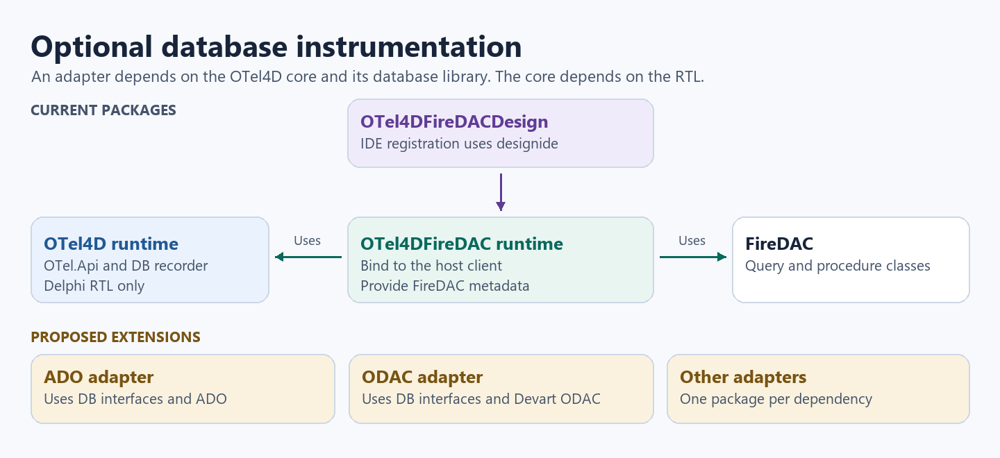

# ADR 0002 — Keep database providers behind optional adapters

**Status.** Accepted for FireDAC. ADO and ODAC are candidates for separate adapters.



## Context and decision

OTel4D serves applications with and without database access. Delphi components must keep their concrete types, component ownership, and published properties for DFM streaming. Database frameworks expose different operation APIs and have independent package and licensing constraints.

Keep three package responsibilities. The core owns telemetry and the provider-neutral database recorder. The optional `OTel4DFireDAC` runtime owns FireDAC bindings, metadata, and operation hooks. `OTel4DFireDACDesign` adds IDE registration and depends on the runtime package and `designide`. A headless console, Windows service, or any application without FireDAC can build and run with the core alone. [Core package](../../source/OTel4D.dpk) · [FireDAC runtime package](../../source/firedac/OTel4DFireDAC.dpk) · [IDE package](../../source/firedac/design/OTel4DFireDACDesign.dpk)

## Interfaces and ownership

- `IOTelDatabaseRecorder` creates an operation with an instance method. It retains the tracer and the duration instrument for that instrumentation scope.
- `IOTelDatabaseOperation` reports a failure and finishes the capture once. The in-flight operation retains its recorder even if the binding detaches. Call `Finish` on the same thread in a `finally` block.
- `IOTelDatabaseMetadata` supplies bounded database and operation names from the provider. FireDAC reads its command metadata after the original call. Keep the supplied defaults when the provider cannot identify a name.
- `IOTelFireDACInstrumentation` and `IOTelFireDACDataSet` expose the binding and dataset behavior. Their concrete components still use Delphi ownership and the published `Instrumentation` property. Use those interfaces within the lifetime of the components.

The adapter runs the database call once, propagates the original result and exception, and leaves SQL, parameters, credentials, and exception messages out of telemetry. The shared recorder emits a client span and `db.client.operation.duration` in seconds. A metric can be recorded even if the parent trace is unsampled. Use the same measurement and error classification on the corresponding span and metric. [Database contracts](../../source/adapters/database/OTel.Instrumentation.Database.Contracts.pas) · [Recorder](../../source/adapters/database/OTel.Instrumentation.Database.Recorder.pas) · [Database spans](https://opentelemetry.io/docs/specs/semconv/db/database-spans/) · [Duration metric](https://opentelemetry.io/docs/specs/semconv/db/database-metrics/#metric-dbclientoperationduration)

Putting driver logic in the core would make every installation carry driver dependencies. Reusing the FireDAC component or its driver callbacks in another adapter would make ADO or ODAC installations depend on FireDAC. The shared contracts retain a single implementation of span, duration, and error capture while each optional package owns its provider calls. Existing application entry points, component classes, and DFM property names stay compatible. Rebuild applications that use the updated BPLs.

## Add another provider

| Provider | First implementation boundary | Evidence to collect |
| --- | --- | --- |
| ADO | Wrap synchronous `TADOQuery.Open` and `ExecSQL` and `TADOStoredProc.ExecProc` at a call site the host owns. In Delphi Tokyo, `ExecSQL` and `ExecProc` are nonvirtual. A subclass alone can miss calls made through the original types. Map the backend from validated provider information and keep `other_sql` when it is unknown. | Compile against the target `Data.Win.ADODB`. Check returned rows, output parameters, original COM/database errors, and a single operation per invocation. [Embarcadero ADO datasets](https://docwiki.embarcadero.com/RADStudio/Florence/en/Using_ADO_datasets) · [TADOQuery.ExecSQL](https://docwiki.embarcadero.com/Libraries/Athens/en/Data.Win.ADODB.TADOQuery.ExecSQL) |
| Devart ODAC | Start with blocking `TOraQuery.Open` or `Execute` and `TOraStoredProc.Execute` behind an explicit wrapper. Use the Oracle database system name when known. Inspect the installed version before choosing a virtual hook, and keep nonblocking execution outside the first version. | Compile with the licensed ODAC version and the target Delphi compiler. Verify Oracle operation results, output parameters, exceptions, and pass-through behavior when telemetry is disabled. [Query operations](https://docs.devart.com/odac/retrieve_modify.htm) · [TOraStoredProc](https://docs.devart.com/odac/devart.odac.torastoredproc.htm) |

Place the adapter in its own runtime package. Add an IDE package only if it needs to register streamable components. At startup, construct a recorder referring to the existing `TOTelTraceClient` and give it an instrumentation scope for the provider. Implement `IOTelDatabaseMetadata` near the driver and acquire one `IOTelDatabaseOperation` per logical operation. Handle telemetry failure separately from the database exception, and preserve database transaction and connection ownership in the host.

An adapter can use a wrapper when the framework's method is nonvirtual. This fragment assumes that `Recorder` is an `IOTelDatabaseRecorder` initialized at startup and that `Metadata` implements `IOTelDatabaseMetadata`.

```pascal
Operation := Recorder.BeginOperation('EXECUTE', Metadata);
try
  try
    RowsAffected := Query.ExecSQL;
  except
    on E: Exception do
    begin
      if Assigned(Operation) then Operation.Failed(E);
      raise;
    end;
  end;
finally
  if Assigned(Operation) then Operation.Finish;
end;
```

Start with a representative integration test on the actual provider. Check one successful call and one database error against the original behavior. Then verify the child span, duration, attribute values, absence of sensitive inputs, and the expected behavior for a disabled client or an unavailable receiver. For DFM components, confirm streamed fields and events and repeat the test when no instrumentation component is bound. [FireDAC verification](../operations.md#verification) · [Integration security rules](../engineering/SECURITY_STANDARDS.md)
