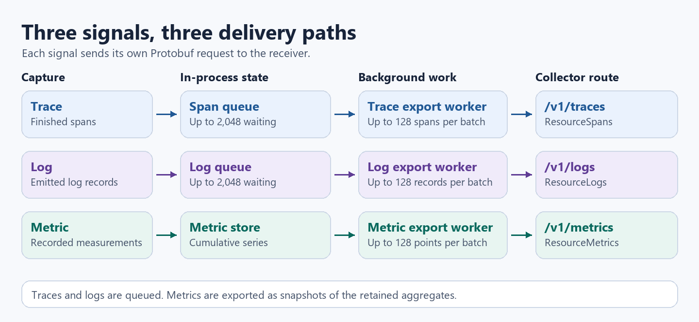
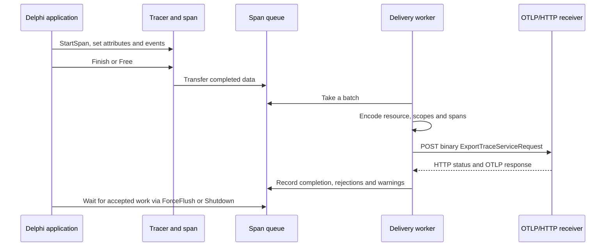

# OTel4D implementation guide

OTel4D sends traces, logs, and metrics as binary OTLP over HTTP from the Delphi application process. The host chooses where to instrument and configures a Collector or compatible receiver. OTel4D owns capture snapshots, queues or aggregation, encoding, and delivery.

| I want to… | Start here |
| --- | --- |
| Build the package and see my first two spans | [Run the local example](integration.md#run-the-local-example) |
| Choose a destination, send credentials or disable tracing | [Configuration reference](integration.md#configuration-reference) |
| Instrument a request, propagate context or record an exception | [Public API and integration patterns](integration.md#public-api-and-ownership) |
| Understand the data path or change the implementation | [Runtime architecture](#runtime-architecture) · [Implementation decisions](#implementation-decisions) · [Source map](source-map.md) |
| Investigate missing spans or interpret a failed shutdown | [Delivery and troubleshooting](operations.md) |
| Reproduce the compiler, wire and receiver checks | [Verification](operations.md#verification) |

## Scope and compatibility

| Capability | Current implementation |
| --- | --- |
| Runtime | Delphi 10.2 Tokyo, Windows Win32. The console example exercises the same public API available to VCL, FMX and Windows service applications on this target. Other compilers and platforms require separate validation. |
| Tracing | Manual spans, five span kinds, scalar attributes, named events, exception events, status, parent-based sampling and W3C trace context. |
| Resource and scope | One service name per client. Each tracer supplies an instrumentation scope name and optional version. |
| Delivery | An in-process worker sends uncompressed binary Protobuf to an HTTP or HTTPS endpoint. The application supplies configuration and instrumentation. |
| Logs and metrics | Structured log records with trace correlation. Cumulative counters, up-down counters and explicit-bucket histograms. |
| FireDAC | Optional query and stored procedure components instrument supported blocking operations. Runtime and IDE packages are separate. |
| Outside this implementation | Baggage, links, arbitrary resource attributes, configurable samplers, gRPC, HTTP/JSON, disk spooling and automatic instrumentation of existing unmodified components. |

This implementation covers a defined subset of the OpenTelemetry API. See the [telemetry guide](telemetry.md) for log and metric types, independent workers, and FireDAC migration. [OpenTelemetry tracing API](https://opentelemetry.io/docs/specs/otel/trace/api/) · [OTLP specification](https://opentelemetry.io/docs/specs/otlp/)

## Runtime architecture

The core defines ports for capture, configuration, timing and delivery. Bootstrap supplies the implementations. The host continues to use the public facade and its own architecture. [Decision and dependency diagram](adr/0003-hexagonal-telemetry.md)

| Component | Owner and responsibility |
| --- | --- |
| Public entry | [OTel.Api](../source/adapters/api/OTel.Api.pas) exposes the application types and constants. `TOTel.Open` takes a configuration snapshot, constructs a client and releases the temporary snapshot. |
| Configuration | The [options](../source/domain/OTel.Model.Dto.Options.pas) carry caller overrides and the [configuration](../source/domain/OTel.Model.Dto.Configuration.pas) holds resolved values. The [environment DAO](../source/adapters/configuration/OTel.Model.Dao.Environment.pas) reads settings. The [configuration service](../source/application/OTel.Model.Service.Configuration.pas) applies precedence. The [endpoint view](../source/adapters/configuration/OTel.View.TraceEndpoint.pas) validates and renders the final URL. |
| Capture | The [tracer](../source/adapters/api/OTel.Controller.Trace.pas) creates each [span](../source/adapters/api/OTel.Controller.Span.pas). The span tracks time, attributes and events, then submits its data once. [Span data](../source/domain/OTel.Model.Dto.Span.pas) owns its [events](../source/domain/OTel.Model.Dto.SpanEvent.pas). |
| Context | The [trace context service](../source/adapters/windows/OTel.Model.Service.TraceContext.pas) generates IDs, validates headers and scopes the active context to the executing thread. |
| Queue | The [span queue](../source/adapters/runtime/OTel.Controller.SpanQueue.pas) protects the bounded FIFO, tracks accepted and completed work, and wakes the worker or flush callers. |
| Worker | The [application session](../source/application/OTel.Application.Session.pas) uses typed ports to manage an independent thread for each active signal. The [batch worker](../source/adapters/runtime/OTel.Controller.DeliveryWorker.pas) sends traces and logs from their own queues. The [metric worker](../source/adapters/runtime/OTel.Controller.MetricWorker.pas) sends cumulative snapshots. |
| Wire format | The [trace encoder](../source/adapters/otlp/OTel.View.TraceProtobuf.pas) writes a trace export request. The [shared response decoder](../source/adapters/otlp/OTel.View.ProtobufResponse.pas) reads the receiver's acknowledgement. |
| HTTP | The [HTTP transport](../source/adapters/otlp/OTel.Transport.Http.pas) validates export headers, uses the platform HTTP client, applies retry rules and returns the number of unconfirmed spans. |

The span monitor serializes updates with `Finish`. Finishing detaches the data from the public object. Later calls cannot change the queued payload. A reference-counted sink keeps the queue alive while a tracer or span still refers to it. A closed queue declines new work. Hosts must still synchronize access to any object they are about to free.

## From a Delphi value to the wire

| Source | OTLP representation |
| --- | --- |
| Configured service | `ResourceSpans.resource.attributes["service.name"]` |
| Tracer name and version | `ScopeSpans.scope.name` and optional `version` |
| Local or propagated identity | A 16-byte trace ID, an 8-byte span ID and, for children, an 8-byte parent span ID. W3C headers use lowercase hexadecimal text. |
| Sampling and origin | The low flag byte carries the incoming trace flags. For children, the OTLP flags also indicate whether the parent is known to be remote or local. |
| Start and end | Unix epoch nanoseconds. Start time uses the Windows clock. End time adds the monotonic elapsed duration to the start. Event timestamps use the Windows clock. The wire unit does not imply nanosecond clock resolution. |
| Span kind | Internal, server, client, producer or consumer, encoded as the corresponding OTLP enum. |
| Span attributes | Delphi `string`, `Int64`, `Boolean` and `Double` select the matching Protobuf `AnyValue` field. Strings use UTF-8. An existing key can be updated. |
| Events and status | Named events carry timestamps. Exception events can carry `exception.type` and optional `exception.message`. Error status can have a description. Unset status uses the Protobuf default. |

The encoder groups spans under the configured resource and writes scope metadata for each run of spans from the same scope. Consumers should use IDs to reconstruct order and parentage. A child can finish and be delivered before its parent. [Canonical trace schema](https://github.com/open-telemetry/opentelemetry-proto/blob/main/opentelemetry/proto/trace/v1/trace.proto) · [Export request and response](https://github.com/open-telemetry/opentelemetry-proto/blob/main/opentelemetry/proto/collector/trace/v1/trace_service.proto)

## Implementation decisions

The sections below distinguish protocol requirements from OTel4D's local choices. Every data path uses the same [source and verification map](source-map.md) and [compatibility boundary](opentelemetry-reference.md#what-the-delphi-implementation-covers).

### Configure once at startup

`TOTel.Open` reads the environment, applies explicitly supplied options, renders the trace route, and builds the client. The API borrows options during this call and the client retains its own values. Snapshotting gives each client one consistent configuration and keeps environment parsing off the capture path. `LoadConfiguration` is useful for previewing the trace endpoint. It does not connect to the receiver and does not validate the deferred log and metric transport. Log and metric settings are checked when the corresponding enabled accessor first creates a worker. [Configuration controller](../source/adapters/api/OTel.Controller.Configuration.pas) · [Client](../source/adapters/api/OTel.Controller.TraceClient.pas)

A URL configured as the common base receives each signal's suffix. A signal URL is an exact override. This lets one application use standard Collector routes or a reverse proxy with custom routes and suffixes without changing instrumentation code. The renderer keeps the base prefix and query, validates percent escapes, and rejects URL user information and fragments. An explicit code-level base replaces an environment-provided signal endpoint. Signal header settings replace the entire generic list, so a destination-specific setting can supply the complete set of credentials and routing headers it requires. [Endpoint renderer](../source/adapters/configuration/OTel.View.TraceEndpoint.pas) · [OTLP exporter URL and header rules](https://opentelemetry.io/docs/specs/otel/protocol/exporter/)

On Windows, the runtime uses Delphi's `THTTPClient` and platform certificate trust. The application supplies header values, including any Bearer token, from its configuration. Headers are scoped to OTLP export, and automatic redirects are disabled so the configured credentials stay with the chosen target. The parser checks header names, size, escapes, duplicates, and decoded control characters before constructing the request. [Delphi Bearer setup](integration.md#configure-bearer-authentication-in-delphi) · [Transport](../source/adapters/otlp/OTel.Transport.Http.pas)

### Keep capture separate from export

The Model owns state and validity rules, the Controller owns capture, lifecycle, and delivery, and the View maps state to endpoints and OTLP bytes. In this library the View is an output renderer. The VCL form lives in the sample, with the same runtime API available to other hosts. Direct export fits a Delphi process that already has an HTTPS destination. The Collector can still receive, process, fan out, and export the telemetry. Binary Protobuf over HTTP is a supported transport and works with the available Delphi RTL HTTP client, so the tested build can carry all three signals without a gRPC runtime or generated Protobuf classes. [Design decision](adr/0003-hexagonal-telemetry.md) · [OTLP transports](https://opentelemetry.io/docs/specs/otlp/#protocol-details) · [Collector components](https://opentelemetry.io/docs/collector/components/)

The encoder writes a resource containing `service.name`, groups the batch by instrumentation scope as it emits the repeated fields, and writes each signal's own envelope. A shared writer handles wire primitives and maps the four scalar Delphi types to Protobuf `AnyValue`. Separate views preserve the trace, log, and metric schema boundaries. They also allow the Python fixtures to decode Delphi output with independent bindings built from the canonical schemas. [Binary writer](../source/adapters/otlp/OTel.View.Protobuf.pas) · [Canonical schemas](https://github.com/open-telemetry/opentelemetry-proto/tree/main/opentelemetry/proto) · [Fixture map](source-map.md#build-sample-and-check)

### Represent trace scope and lifetime explicitly

A tracer is a named scope. `StartSpan` chooses a valid explicit parent first, then an active local context, then starts a root. Creating a span and activating it are separate operations. `WithContext` installs copied W3C data in a Delphi thread-local scope and restores the previous context in `finally`. This fits a synchronous call with nested scopes and keeps a reused worker thread from retaining a previous request's context. A new task needs an explicit copy of the headers before it activates the context. The host injects and extracts the headers on HTTP requests. [Trace API](https://opentelemetry.io/docs/specs/otel/trace/api/) · [Context API](https://opentelemetry.io/docs/specs/otel/context/) · [W3C Trace Context](https://www.w3.org/TR/trace-context/)

Roots are sampled locally and children inherit the parent's sampled flag. Unsampled children can still carry trace context for propagation and log correlation without allocating a recording payload. A known parent is encoded with the corresponding local or remote OTLP flags. OTel4D generates IDs with the Windows GUID facility and combines a wall-clock start time with elapsed monotonic time for the end. This prevents an adjustment to the wall clock during an operation from reversing the elapsed duration. [Context implementation](../source/adapters/windows/OTel.Model.Service.TraceContext.pas) · [Span construction and finish](../source/adapters/api/OTel.Controller.Span.pas) · [Trace SDK sampling](https://opentelemetry.io/docs/specs/otel/trace/sdk/#sampling)

The span sets bounds on attributes and events and tracks drops on the OTLP record. `Finish` transfers the completed object to the sink exactly once. A caller can set a span status and separately record an exception event. Exception class capture is the default and message capture is opt-in because application exceptions can carry private values. [Span API](integration.md#public-api-and-ownership) · [Exception conventions](https://opentelemetry.io/docs/specs/otel/trace/exceptions/)

### Correlate records where the log is emitted

`Emit` copies attributes and records the observed timestamp and active W3C IDs before handing the record to a worker. These values describe the producer thread and capture time. The exporter thread would have a different context and clock reading. A caller-supplied event time remains separate from the timestamp at which OTel4D observed it. The six supported severity labels map to the first severity number in each OTLP range, from `TRACE=1` to `FATAL=21`. The host continues to own its logging framework and decides what an optional bridge forwards. [Logger](../source/adapters/api/OTel.Controller.Logger.pas) · [Log encoder](../source/adapters/otlp/OTel.View.LogProtobuf.pas) · [Logs data model](https://opentelemetry.io/docs/specs/otel/logs/data-model/)

### Aggregate metrics inside the process

The meter registers synchronous instruments by scope and case-insensitive metric name. The store reuses identical definitions and raises on conflicting kind, unit, description, or bounds. It sorts attribute keys and includes value types when building the series key. This keeps label insertion order from splitting a series and distinguishes a number from a string with the same text. Limits of 64 instruments and 128 regular series per instrument bound memory. Measurements with additional combinations accumulate in a separate `otel.metric.overflow=true` series for that instrument. These counts are local choices. [Metric store](../source/application/OTel.Model.Service.MetricStore.pas) · [SDK instrument and cardinality rules](https://opentelemetry.io/docs/specs/otel/metrics/sdk/)

The store updates integer sums and explicit-bucket histograms under a monitor. The reader takes a cumulative snapshot on its interval, on a flush request, or while closing with unprocessed measurements. It releases the monitor before encoding and sending up to 128 points per request. This keeps network latency off measurement calls and lets subsequent snapshots include measurements from a rejected export. Counter inputs must be nonnegative except for up-down counters, and the runtime also rejects negative or nonfinite histogram observations and arithmetic overflow. Choose bounds in the recorded unit. The FireDAC adapter uses its own seconds boundaries. [Metric worker](../source/adapters/runtime/OTel.Controller.MetricWorker.pas) · [OTLP metric data model](https://opentelemetry.io/docs/specs/otel/metrics/data-model/)

### Bound background delivery and account for loss

Traces and logs each have a separate 2,048-item queue. The worker can send up to 128 records when a batch is full, the schedule reaches about one second, or the host requests a drain. The queue drops new recordings when full instead of waiting for the destination. Metrics have a separate worker because their source is an aggregate snapshot instead of an event stream. Each encoder and HTTP exchange runs outside the producer's queue or aggregation monitor. [Batched signal](../source/adapters/runtime/OTel.Controller.BatchedSignal.pas) · [Batch worker](../source/adapters/runtime/OTel.Controller.DeliveryWorker.pas) · [SDK batch span processor](https://opentelemetry.io/docs/specs/otel/trace/sdk/#batching-processor)

An HTTP 200 response can acknowledge all or part of a request. OTel4D records rejected counts and warning presence without re-sending a partially accepted request. Retryable HTTP failures reuse the same request bytes, use exponential backoff with jitter, and honor a longer valid `Retry-After` within the request budget. The receiver can receive duplicates after an acknowledgement is lost. Response size checks and terminal handling for permanent failures limit the work associated with each batch. [OTLP/HTTP delivery](https://opentelemetry.io/docs/specs/otlp/#otlphttp) · [Delphi response handling and counters](operations.md)

`ForceFlush` captures accepted work per active signal, wakes the workers, and applies a shared wait deadline. `Shutdown` first closes intake. A wait timeout can leave a worker running until it drains or the client is freed. Client destruction requests abort and joins owned workers. Reference-counted sinks and stores make retained instrumentation handles stop recording after shutdown. The application still owns the Delphi objects and coordinates their destruction with producers. [Client lifecycle](../source/adapters/api/OTel.Controller.TraceClient.pas) · [Ownership and timeouts](operations.md#flush-and-shutdown)

### Keep FireDAC instrumentation at the operation boundary

The optional runtime package subclasses `TFDQuery` and `TFDStoredProc` and instruments blocking `OpenCursor` and `Execute` calls. The host replaces selected component classes while keeping DFM names, persistent fields, and callbacks. The binding is explicit and the design-time package registers palette components separately. This avoids loading FireDAC or the IDE API in the core runtime and avoids replacing callbacks owned by the host. Each override preserves the inherited return path and re-raises the original error when the operation fails. [Migration guide](telemetry.md#migrate-a-firedac-data-module) · [FireDAC units](source-map.md#firedac)

The adapter captures a database client span and a duration histogram in seconds. It uses the span's duration when recorded and a separate stopwatch when sampling prevents a span record. This lets measurements continue under an unsampled trace. It derives bounded `db.system.name` and `db.operation.name` values from FireDAC metadata and records a bounded `error.type` on failure. The implementation deliberately captures a subset of the database conventions. The captured values omit SQL statements, parameter values, connection details, and exception message text. [Database spans](https://opentelemetry.io/docs/specs/semconv/db/database-spans/) · [Database operation duration](https://opentelemetry.io/docs/specs/semconv/db/database-metrics/#metric-dbclientoperationduration) · [Shared database operation](../source/adapters/database/OTel.Instrumentation.Database.Operation.pas) · [Provider metadata](../source/firedac/OTel.Instrumentation.FireDAC.Operation.pas) · [Database adapter decision](adr/0002-optional-database-adapters.md)

### Run examples and validate at the appropriate layer

The first trace uses the Collector's debug pipeline to expose a parent and a child. The VCL demo uses a background send thread, a reusable local session, and a Collector-backed Grafana lab so a learner can inspect traces, log correlation, and metric aggregation in one workflow. The lab smoke test starts with synthetic OTLP input to isolate the backend from the Delphi build. The demo verifier queries the result of a real Delphi process. The release workflow creates versioned source archives and the optional local bundle uses a licensed Delphi installation to build Win32 binaries. [First trace](integration.md#run-the-local-example) · [VCL demo](../examples/TelemetryDemo/README.md) · [Local lab](../infra/observability/README.md) · [Source releases](github-releases.md)

## Extending the library

For another application integration, start with an operation boundary such as an HTTP request handler or a database command. Let an adapter extract incoming context, call the public tracer, mark failures, propagate context to downstream work and finish in a `finally` block. Keep framework-specific units and callbacks in adapters. For an automatic adapter, specify how the host registers it, when it detaches and how to avoid instrumenting OTel4D's own HTTP traffic.

For a new span field, define its ownership and limits in the domain, expose the operation through the capture API, map it to the official Protobuf field in the OTLP adapter, and verify the decoded value through a real Delphi consumer. DTOs and entities are classes. Place behavior on classes and keep the public API framework-independent. Register new units in both the [DPK](../source/OTel4D.dpk) and [DPROJ](../source/OTel4D.dproj). [Design decision](adr/0003-hexagonal-telemetry.md) · [Delphi development conventions](../.agents/skills/develop-delphi/SKILL.md) · [Engineering quality gates](engineering/QUALITY_GATES.md)
