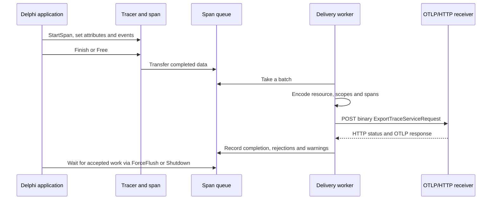

# OTel4D implementation guide

OTel4D instruments Delphi operations and sends completed spans as binary OTLP over HTTP from the application process. The application links the library, opens a client and marks operations. OTel4D owns the queue, encoder, HTTP requests and response handling. A destination can be an OpenTelemetry Collector or a backend that accepts OTLP/HTTP traces.

| I want to… | Start here |
| --- | --- |
| Build the package and see my first two spans | [Run the local example](integration.md#run-the-local-example) |
| Choose a destination, send credentials or disable tracing | [Configuration reference](integration.md#configuration-reference) |
| Instrument a request, propagate context or record an exception | [Public API and integration patterns](integration.md#public-api-and-ownership) |
| Understand the data path or change the implementation | [Runtime architecture](#runtime-architecture) |
| Investigate missing spans or interpret a failed shutdown | [Delivery and troubleshooting](operations.md) |
| Reproduce the compiler, wire and receiver checks | [Verification](operations.md#verification) |

## Scope and compatibility

| Capability | Current implementation |
| --- | --- |
| Runtime | Delphi 10.2 Tokyo, Windows Win32. The console example exercises the same public API available to VCL, FMX and Windows service applications on this target. Other compilers and platforms require separate validation. |
| Tracing | Manual spans, five span kinds, scalar attributes, named events, exception events, status, parent-based sampling and W3C trace context. |
| Resource and scope | One service name per client. Each tracer supplies an instrumentation scope name and optional version. |
| Delivery | An in-process worker sends uncompressed binary Protobuf to an HTTP or HTTPS endpoint. The application supplies configuration and instrumentation. |
| Logs and metrics | Structured log records with trace correlation. Cumulative counters, up-down counters and explicit-bucket histograms. |
| FireDAC | Optional query and stored procedure components instrument supported blocking operations. Runtime and IDE packages are separate. |
| Outside this implementation | Baggage, links, arbitrary resource attributes, configurable samplers, gRPC, HTTP/JSON, disk spooling and automatic instrumentation of existing unmodified components. |

This implementation covers a defined subset of the OpenTelemetry API. See the [telemetry guide](telemetry.md) for log and metric types, independent workers, and FireDAC migration. [OpenTelemetry tracing API](https://opentelemetry.io/docs/specs/otel/trace/api/) · [OTLP specification](https://opentelemetry.io/docs/specs/otlp/)

## Runtime architecture

MVC applies inside the library. The View renders a destination URL or a wire representation. A host application can retain its own architecture. All paths below are relative to the [package project](../source/OTel4D.dproj).

| Component | Owner and responsibility |
| --- | --- |
| Public entry | [OTel.Api](../source/controller/OTel.Api.pas) exposes the application types and constants. `TOTel.Open` takes a configuration snapshot, constructs a client and releases the temporary snapshot. |
| Configuration | The [options](../source/model/dto/OTel.Model.Dto.Options.pas) carry caller overrides and the [configuration](../source/model/dto/OTel.Model.Dto.Configuration.pas) holds resolved values. The [environment DAO](../source/model/dao/OTel.Model.Dao.Environment.pas) reads settings. The [configuration service](../source/model/service/OTel.Model.Service.Configuration.pas) applies precedence. The [endpoint view](../source/view/OTel.View.TraceEndpoint.pas) validates and renders the final URL. |
| Capture | The [tracer](../source/controller/OTel.Controller.Trace.pas) creates each [span](../source/controller/OTel.Controller.Span.pas). The span tracks time, attributes and events, then submits its data once. [Span data](../source/model/dto/OTel.Model.Dto.Span.pas) owns its [events](../source/model/dto/OTel.Model.Dto.SpanEvent.pas). |
| Context | The [trace context service](../source/model/service/OTel.Model.Service.TraceContext.pas) generates IDs, validates headers and scopes the active context to the executing thread. |
| Queue | The [span queue](../source/controller/OTel.Controller.SpanQueue.pas) protects the bounded FIFO, tracks accepted and completed work, and wakes the worker or flush callers. |
| Worker | The [client](../source/controller/OTel.Controller.TraceClient.pas) manages an independent thread for each active signal. The [batch worker](../source/controller/OTel.Controller.DeliveryWorker.pas) sends traces and logs from their own queues. The [metric worker](../source/controller/OTel.Controller.MetricWorker.pas) sends cumulative snapshots. |
| Wire format | The [trace encoder](../source/view/OTel.View.TraceProtobuf.pas) writes a trace export request. The [shared response decoder](../source/view/OTel.View.ProtobufResponse.pas) reads the receiver's acknowledgement. |
| HTTP | The [HTTP transport](../source/controller/OTel.Transport.Http.pas) validates export headers, uses the platform HTTP client, applies retry rules and returns the number of unconfirmed spans. |

The span monitor serializes updates with `Finish`. Finishing detaches the data from the public object. Later calls cannot change the queued payload. A reference-counted sink keeps the queue alive while a tracer or span still refers to it. A closed queue declines new work. Hosts must still synchronize access to any object they are about to free.

## From a Delphi value to the wire

| Source | OTLP representation |
| --- | --- |
| Configured service | `ResourceSpans.resource.attributes["service.name"]` |
| Tracer name and version | `ScopeSpans.scope.name` and optional `version` |
| Local or propagated identity | A 16-byte trace ID, an 8-byte span ID and, for children, an 8-byte parent span ID. W3C headers use lowercase hexadecimal text. |
| Sampling and origin | The low flag byte carries the incoming trace flags. For children, the OTLP flags also indicate whether the parent is known to be remote or local. |
| Start and end | Unix epoch nanoseconds. Start time uses the Windows clock. End time adds the monotonic elapsed duration to the start. Event timestamps use the Windows clock. The wire unit does not imply nanosecond clock resolution. |
| Span kind | Internal, server, client, producer or consumer, encoded as the corresponding OTLP enum. |
| Span attributes | Delphi `string`, `Int64`, `Boolean` and `Double` select the matching Protobuf `AnyValue` field. Strings use UTF-8. An existing key can be updated. |
| Events and status | Named events carry timestamps. Exception events can carry `exception.type` and optional `exception.message`. Error status can have a description. Unset status uses the Protobuf default. |

The encoder groups spans under the configured resource and writes scope metadata for each run of spans from the same scope. Consumers should use IDs to reconstruct order and parentage. A child can finish and be delivered before its parent. [Canonical trace schema](https://github.com/open-telemetry/opentelemetry-proto/blob/main/opentelemetry/proto/trace/v1/trace.proto) · [Export request and response](https://github.com/open-telemetry/opentelemetry-proto/blob/main/opentelemetry/proto/collector/trace/v1/trace_service.proto)

## Extending the library

For another application integration, start with an operation boundary such as an HTTP request handler or a database command. Let an adapter extract incoming context, call the public tracer, mark failures, propagate context to downstream work and finish in a `finally` block. Keep framework-specific units and callbacks out of the base Model. For an automatic adapter, specify how the host registers it, when it detaches and how to avoid instrumenting OTel4D's own HTTP traffic.

For a new span field, define its ownership and limits in the Model, expose the operation through the capture controller, map it to the official Protobuf field in the View, and verify the decoded value through a real Delphi consumer. DTOs and entities are classes. Place behavior on classes and keep the public API framework-independent. Register new units in both the [DPK](../source/OTel4D.dpk) and [DPROJ](../source/OTel4D.dproj). [Design decision](adr/0001-library-mvc-and-otlp-http.md) · [Delphi development conventions](../.agents/skills/develop-delphi/SKILL.md) · [Engineering quality gates](engineering/QUALITY_GATES.md)
