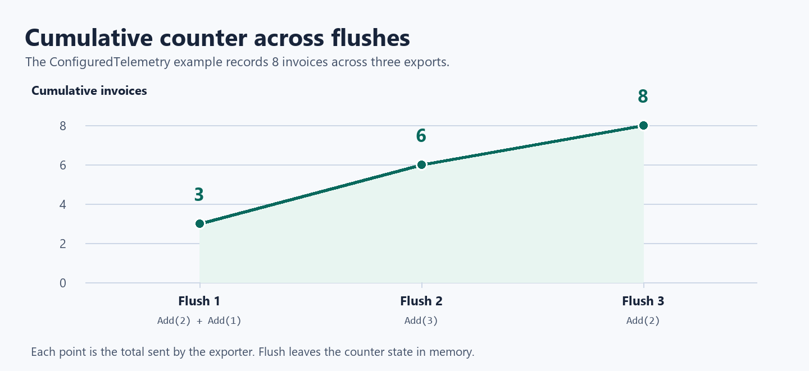

# Use structured logs, metrics and FireDAC instrumentation

## Configure the signals

[Configure the client in Delphi](integration.md#configure-the-client-in-delphi) to set the base URL, headers, timeouts, and metric interval during startup.

The same client provides traces, logs and metrics. `GetLogger` and `GetMeter` activate their delivery workers on the first enabled call. `TOTel.Open` snapshots the process environment and programmatic overrides. Use `service.name` consistently and choose an instrumentation scope representing the emitting module.

| Purpose | Programmatic option | Environment setting |
| --- | --- | --- |
| Base URL for all signals | `Endpoint` | `OTEL_EXPORTER_OTLP_ENDPOINT` |
| Exact destination | `LogsEndpoint` or `MetricsEndpoint` | `OTEL_EXPORTER_OTLP_LOGS_ENDPOINT` or `OTEL_EXPORTER_OTLP_METRICS_ENDPOINT` |
| Export request headers | `LogsHeaders` or `MetricsHeaders` | `OTEL_EXPORTER_OTLP_{LOGS,METRICS}_HEADERS` |
| Wire protocol | `LogsProtocol` or `MetricsProtocol` | `OTEL_EXPORTER_OTLP_{LOGS,METRICS}_PROTOCOL` |
| Per-request budget, including retry waits | `LogsTimeoutMs` or `MetricsTimeoutMs` | `OTEL_EXPORTER_OTLP_{LOGS,METRICS}_TIMEOUT` |
| Periodic metric collection interval | `MetricsIntervalMs` | `OTEL_METRIC_EXPORT_INTERVAL` |
| Disable all signals | `SdkDisabled` | `OTEL_SDK_DISABLED=true` |
| Disable logs or metrics independently | — | `OTEL_LOGS_EXPORTER=none` or `OTEL_METRICS_EXPORTER=none` |

Programmatic options take precedence over signal-specific environment values, which take precedence over the generic `OTEL_EXPORTER_OTLP_` values. Within one source, an exact endpoint wins over a base URL. With a base of `https://collector.example/tenant`, the destination paths are `/tenant/v1/traces`, `/tenant/v1/logs` and `/tenant/v1/metrics`. Exact destinations keep their path and query. The default base is `http://localhost:4318`. The protocol is `http/protobuf`. Request budgets default to 10 seconds and the metric interval to 60 seconds. Copy authentication into the export configuration only. [Endpoint and header details](integration.md#configuration-reference) · [OTLP exporter specification](https://opentelemetry.io/docs/specs/otel/protocol/exporter/)

## Send logs

Open a logger with `Client.GetLogger('billing.workflows', '1.0')`. Emit `llTrace`, `llDebug`, `llInfo`, `llWarn`, `llError` or `llFatal`, a message and optional `TOTelAttributes`. The optional last argument is source time in Unix epoch nanoseconds. Zero uses the capture time. A logger can reuse the current thread's `Span.WithContext` scope. Unsampled trace IDs remain available for correlation.

```pascal
Attributes := TOTelAttributes.Create;
try
  Attributes.Put('attempt', Int64(2));
  Attributes.Put('cached', False);
  Logger.Emit(llInfo, 'Invoice calculated', Attributes);
finally
  Attributes.Free;
end;
```

The application owns returned loggers. Share a logger across producers if its owner keeps it alive. Use a separate attribute container for each concurrently mutated set. `Emit` snapshots the set before returning. A log body uses up to 4,096 UTF-16 units. Each attribute set can keep 16 keys, capped at 128 units per key and 256 per string value. `DroppedLogs` reports queue overflow, `RejectedLogs` reports unconfirmed delivery, and `LogDeliveryWarnings` counts receiver warnings.

For an existing logger, wire an application-owned bridge to approved events and redact before emission. The example bridge sends a fixed message and the Delphi exception class. [Host log bridge](../examples/OTel.Example.LogBridge.pas)

## Record metrics

Use `Meter := Client.GetMeter('billing.workflows', '1.0')`, then create instruments and reuse them. Free each returned meter and instrument handle. A handle retains the metric store. Measurement methods stay safe after shutdown and stop accepting new values.

| Instrument | Example call | Meaning |
| --- | --- | --- |
| Monotonic integer counter | `Completed := Meter.CreateCounter('billing.completed', '{invoice}')` | `Completed.Add(1)` accumulates completed invoices. |
| Signed integer up-down counter | `InFlight := Meter.CreateUpDownCounter('billing.in_flight', '{invoice}')` | Use `Add(1)` on entry and `Add(-1)` in a `finally` block. |
| Histogram | `Duration := Meter.CreateHistogram('billing.duration', 's', 'Invoice duration', [0.01, 0.1, 1.0])` | `Duration.RecordValue(0.08)` records seconds. Buckets include the upper boundary. |

All measurement methods accept optional typed attributes. Repeated identical definitions in one scope share their aggregation. Conflicting definitions and registrations beyond the client instrument limit raise `EOTelConfiguration`. Invalid measurements increment `InvalidMetricMeasurements`. `RejectedMetricPoints` and `MetricDeliveryWarnings` describe delivery. Each histogram can have up to 32 strictly increasing finite boundaries. Choose boundaries in the recorded unit. The store accepts nonnegative finite histogram values, rejects negative increments on monotonic counters, and detects numeric overflow. Per instrument, the first 128 distinct attribute combinations receive their own series and further combinations share the overflow point. Measurements and snapshots are cumulative over the instrument's lifetime. A longer export interval affects latency and network use while series remain bounded. Counters and histograms retain recent aggregate state in memory until the client is closed.

Call `ForceFlush` from lifecycle or diagnostic code. Active trace, log and metric workers receive their flush requests before the caller starts waiting. `Shutdown` closes intake and waits under a shared deadline. Neither a partial rejection nor a receiver warning opens another retry of that request. A later metric snapshot continues from the cumulative state. [Flush semantics](operations.md#flush-and-shutdown)



In the console example, the sender exports the cumulative counter over three separate flushes. The values represent additions from the sample. [Delphi source](../examples/ConfiguredTelemetry.dpr)

## Migrate a FireDAC data module

1. Build the core package, then [the FireDAC runtime package](../source/firedac/OTel4DFireDAC.dproj) and [the design-time package](../source/firedac/design/OTel4DFireDACDesign.dproj) for the same Win32 configuration. The BPLs share the core output directory. For runtime package deployment, make `OTel4D.bpl`, `OTel4DFireDAC.bpl` and the FireDAC runtime dependencies available to Windows. The IDE package is `OTel4DFireDACDesign.bpl` and targets the **Component → Install Packages** dialog. To compile from source, add `source/firedac` to the core search paths from the integration guide.
2. Add `OTel.Instrumentation.FireDAC` to the data module. Replace the component classes in the Pascal declaration and the corresponding DFM entries. Keep the existing component names, connection, data sources, child fields and event properties. Add a `TOTelFireDACInstrumentation` component and set the `Instrumentation` property on each migrated component.
3. Create the application client and call `Instrumentation.Bind(Client)` while the data module is idle. Bind before activating queries you want to trace. When shutting down, join database producers, call `Instrumentation.Detach`, then shut down the client. Runtime package users rebuild the application with the matching DCP files.
4. Check an `Open`, an `ExecSQL` and an `ExecProc` under `Span.WithContext`. Find the database client spans as children and inspect the `db.client.operation.duration` histogram in seconds. Preserve separate connections per FireDAC worker thread.

For code-based setup, assign the binding to your migrated components during startup. The data module owns the components. Use the interface within that lifetime and detach the binding before shutting down the client.

```pascal
Query.Instrumentation := Instrumentation;
Proc.Instrumentation := Instrumentation;
Binding := Instrumentation as IOTelFireDACInstrumentation;
Binding.Bind(FClient);
```

FireDAC is an optional adapter with separate runtime and IDE packages. The shared database operation captures the span and histogram behind an interface. [Rationale and approach for ADO or ODAC](adr/0002-optional-database-adapters.md)

The initial coverage is blocking query opens and command execution on migrated components. It includes `ExecSQL` and `ExecProc` after the call reaches `Execute`. Explicit preparation and convenience overloads that fail before that hook, metadata-only opens, later cursor fetching, transaction methods, async command modes and `TFDConnection.ExecSQL` lie outside this coverage. The scope is `OTel4D.FireDAC`. SQL text, parameters and raw exception messages are excluded. The [migrated fixture](../tests/FireDACFixture.dfm) shows component references and a persistent field. The Delphi tests loaded this DFM at runtime. IDE palette registration and designer behavior require interactive validation. [Database span conventions](https://opentelemetry.io/docs/specs/semconv/db/database-spans/)
